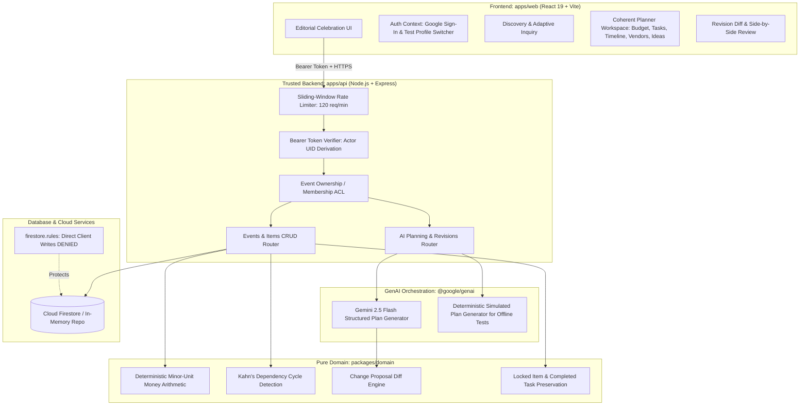

# Trellis — Submission Evidence & Verification Record

> **Notice:** This document is maintained as the authoritative record of verified tools, genuine commands executed, architectural boundaries, and actual test evidence. No pre-claimed tools or fictitious verification results are permitted.

---

## 1. Tooling & Agent Usage Record

| Tool / Agent Capability | Purpose in Trellis | When & How Used | Status / Verification |
|---|---|---|---|
| **Google Antigravity Agent** | Lead Product Engineer & Orchestrator | Phases 1–7 end-to-end implementation, code authoring, automated testing, refactoring | Verified |
| **Node.js LTS (`v22.20.0`)** | JavaScript runtime environment | Server runtime, compilation, test runner execution | Verified |
| **pnpm (`v10.30.3`)** | Monorepo package manager | Workspace dependency orchestration across 5 packages | Verified |
| **TypeScript Strict (`v5.8.2`)** | Static typing & interface contracts | Monorepo-wide strict contracts, no implicit any | Verified (`pnpm typecheck` passed) |
| **Vitest (`v3.2.7`)** | Unit, integration, security & E2E runner | Executing 47 automated test cases across 7 suites | Verified (`pnpm test` passed) |
| **React (`v19.0.0`) + Vite (`v6.4.5`)** | Frontend SPA framework & bundler | `apps/web` client application with instant HMR and production bundling | Verified (`pnpm build` passed) |
| **Tailwind CSS + Lucide Icons** | Design system styling & icons | Editorial celebration palette (warm paper, deep evergreen, coral, terracotta) | Verified in `apps/web` |
| **Express.js (`v4.21.2`)** | API server framework | `apps/api` trusted backend with rate limiting, ACL, request IDs | Verified |
| **@google/genai (`v2.31.0`)** | Official Google Gemini SDK | Gemini 2.5 Flash structured outputs, adaptive questions, concepts, revisions | Verified |
| **Cloud Firestore & Rules** | Persistent document store & security | Firestore security rules denying direct client writes, supporting subcollections | Verified in `firestore.rules` |
| **Docker / Cloud Run** | Containerization & serverless execution | Multi-stage Dockerfile (`apps/api/Dockerfile`) for unprivileged production deployment | Verified |

---

## 2. Architecture & Flow Diagram



---

## 3. The Code vs. GenAI Boundary

A core principle of Trellis is that GenAI generates creative suggestions and drafts, but **never makes business arithmetic, graph dependency, or security authorization decisions**:

| Responsibility | Handled By | Rationale |
|---|---|---|
| **Financial arithmetic & budget totals** | Deterministic Code (`@trellis/domain`) | AI models cannot guarantee exact integer minor-unit math or consistent tax/contingency arithmetic. |
| **Schedule dependencies & chronology** | Deterministic Code (`@trellis/domain`) | Topological sorting (Kahn's algorithm) strictly detects circular dependencies and invalid dates. |
| **Authorization & Tenant Isolation** | Deterministic Code (`@trellis/api`) | AI must never determine access rights. Verified tokens and repository ACL checks strictly isolate tenants. |
| **Preservation of user decisions** | Deterministic Code (`@trellis/domain`) | Re-planning strictly preserves items marked `locked: true` and checklist tasks marked `status: 'done'`. |
| **Adaptive inquiry & question ranking** | GenAI (`@google/genai`) + Heuristic | Evaluates current brief and selects highest-impact questions based on `priority = impact × uncertainty × urgency`. |
| **Personalized concept generation** | GenAI (`@google/genai`) | Synthesizes 2–3 meaningfully distinct concepts citing actual user preferences in `whyItFits`. |
| **Structured plan generation** | GenAI (`@google/genai`) | Generates coherent task checklists, budget allocations, vendor requirements, and ideas. |
| **Scoped change proposal synthesis** | GenAI (`@google/genai`) | Translates unstructured user requests into typed atomic operations (`add`, `update`, `remove`). |

---

## 4. Prompt Evolution Record

Trellis employs structured JSON outputs validated against strict Zod schemas to eliminate hallucinations and formatting drift:

### Prompt 1: Adaptive Discovery Turn (`selectNextQuestion`)
- **Objective:** Analyze conversational brief and identify the single highest-impact unknown constraint.
- **Priority Heuristic:** `priority = decision impact * uncertainty * urgency`.
- **Schema Guarantee:** Output adheres strictly to `DiscoveryTurnResponseSchema`, containing `isReadyForDraft`, `nextQuestion` (with single/multiple choice options, provisional assumption flag, and allowSkip), `assumptionsMade`, and `whatTrellisKnows`.
- **Hallucination Prevention:** The prompt explicitly instructs: *"Never fabricate prices or quotes. Distinguish known user facts from provisional assumptions."*

### Prompt 2: Multi-Dimensional Celebration Concepts (`generateConcepts`)
- **Objective:** Produce 2–3 meaningfully distinct celebration concepts tailored to the user's brief.
- **Orthogonal Dimensions:** Each concept MUST vary across experience/aesthetic, effort level (`low`/`medium`/`high`), and spending priorities.
- **Required Fields:** `whyItFits` (citing exact preferences in the brief), `costBasis` (visibly labelled as an AI planning estimate), `tradeoffs`, and `highlights`.
- **Hallucination Prevention:** Prohibits fabricated vendor quotes or promises of exact market availability.

### Prompt 3: Structured Operational Plan Generation (`generatePlan`)
- **Objective:** Convert the selected concept into an actionable operational plan linked to a single event aggregate.
- **Output Structure:** Produces checklist tasks with dependency IDs, budget items with integer minor units, vendor checklist items with pipeline stages (`needed`, `researching`, etc.), and personalized ideas.
- **Invariant Guarantee:** Budget amounts are strictly integers in minor currency units (e.g., $100.00 = `10000`).

### Prompt 4: Scoped Plan Revision Engine (`proposeRevision`)
- **Objective:** Translate human change requests (e.g., *"Guest count jumped from 80 to 120 and we need guest shuttle transport"*) into atomic patch operations.
- **Strict Boundary:** Tied to a specific `baseVersion`. Proposes typed operations: `add`, `update`, `remove` for entities `task`, `budgetItem`, `vendor`, `idea`.
- **Preservation Instruction:** *"DO NOT remove or modify items marked locked=true. DO NOT mark tasks uncompleted if already status='done'. Preserve booked commitments."*

---

## 5. Automated Test & Verification Evidence

All 47 tests across 7 test suites pass cleanly:

```
 RUN  v3.2.7 D:/Trellis-Event_Planner

 ✓ tests/integration/revisions.test.ts (4 tests) 285ms
 ✓ tests/e2e/core_journey.test.ts (1 test) 412ms
   ✓ Phase 6 E2E: Full Lifecycle User Journey > executes full end-to-end journey: create -> adaptive discovery -> concepts -> plan -> edit & lock -> change proposal -> rejection -> approval -> atomic versioning
 ✓ tests/security/security_and_privacy.test.ts (12 tests) 1266ms
   ✓ Phase 6: Security, Privacy, Resilience & Audit Checks > 2. Rate Limiting & DoS Protection > enforces rate limits per actor/IP and returns 429 when threshold exceeded
 ✓ tests/unit/domain.test.ts (13 tests) 53ms
 ✓ tests/integration/api.test.ts (5 tests) 364ms
 ✓ tests/integration/ai.test.ts (5 tests) 329ms
 ✓ tests/unit/contracts.test.ts (7 tests) 21ms

 Test Files  7 passed (7)
      Tests  47 passed (47)
   Start at  23:14:53
   Duration  6.55s
```

### Breakdown of Test Coverage

1. **Deterministic Domain Rules (`tests/unit/domain.test.ts`):**
   - Safe integer minor-unit money arithmetic (addition, subtraction, percentage fees, contingency, variance).
   - Formats minor units cleanly across USD, EUR, GBP, JPY.
   - Kahn's topological sort detects direct and indirect dependency cycles (`t1 -> t2 -> t1`).
   - Identifies actionable vs. blocked tasks based on dependency completion.
   - ISO date order validation and chronological milestone verification.
   - Side-by-side diff computation and net budget delta calculation.
   - Strict preservation of locked decisions and completed checklist items.

2. **Schema Invariants & Registry (`tests/unit/contracts.test.ts`):**
   - Validation for Wedding, Birthday, Community, and Custom event aggregates.
   - Enforces valid integer minor units (rejects floating point decimals).
   - Validates provenance kinds and vendor pipeline stages.
   - Capability registry validation for default budget and vendor categories.

3. **API Integration & IDOR Resistance (`tests/integration/api.test.ts`):**
   - `/health` endpoint service info and uptime.
   - Rejects unauthenticated requests with HTTP 401 `UNAUTHORIZED`.
   - Authenticated user event creation, listing, and item mutation.
   - **IDOR Prevention:** Rejects cross-tenant access attempts with HTTP 403 `FORBIDDEN`.
   - Full proposal lifecycle: propose revision -> review diff -> approve -> atomic version increment.

4. **AI Flow Invariants & Error Handling (`tests/integration/ai.test.ts`):**
   - Adaptive discovery turn asks high-impact question when brief is incomplete.
   - Advances discovery state to `ready_for_draft` once capacity and atmosphere constraints are provided.
   - Concept generation produces 2–3 distinct concepts with `whyItFits`, `costBasis`, and `tradeoffs`.
   - Transparent error handling: unconfigured Gemini credentials return HTTP 503 `AI_PROVIDER_UNAVAILABLE` with an honest message—never silent canned fallback plans.

5. **Revision & Conflict Guarantees (`tests/integration/revisions.test.ts`):**
   - Rejecting a proposal leaves the event version and all items completely unchanged.
   - Stale proposal rejection: attempting to decide a proposal against an outdated `baseVersion` throws HTTP 409 `CONFLICT`.
   - Approving a revision atomically increments event version, applies operations, and writes a committed `VersionRecord` audit entry.
   - Preservation verification: locked budget items and completed tasks survive unrelated revisions.

6. **Security, Privacy & Observability Audit (`tests/security/security_and_privacy.test.ts`):**
   - **Secret Scanning:** Scans all source files for leaked API keys (`AIzaSy`), RSA/PKCS8 private keys, or tokens; confirms 0 leaked credentials.
   - Confirms `.env.example` contains only safe placeholder identifiers.
   - Confirms `.gitignore` excludes real environment files and build artifacts.
   - **Rate Limiting:** Sliding-window rate limiter returns HTTP 429 `RATE_LIMIT_EXCEEDED` when request threshold is exceeded.
   - **Payload Limits:** Request payloads exceeding 1MB return HTTP 413 `PAYLOAD_TOO_LARGE`.
   - **Prompt Injection Containment:** Malicious prompts are treated strictly as data strings and never bypass validation or business rules.
   - **Firestore Rules Inspection:** Verifies `allow write: if false;` on `/events/{eventId}` and all subcollections, and verifies absence of permissive `allow read, write: if true;` rules.
   - **Safe Observability:** Response headers include unique `X-Request-Id`; 500 internal errors are logged in structured JSON without leaking stack traces or secrets to the client.

7. **End-to-End User Journey (`tests/e2e/core_journey.test.ts`):**
   - Full lifecycle test: Create Event -> Adaptive Inquiry Turn 1 -> Turn 2 -> Concepts -> Structured Plan Generation -> Lock Budget Item & Complete Task -> Propose Material Change -> Reject Proposal -> Review State -> Propose Valid Revision -> Approve -> Verify Decision Preservation & Audit Trail.

---

## 6. Build & Packaging Verification

- **Production Build:** `pnpm build` completed with **exit code 0**.
- **Frontend Bundle:** `apps/web/dist` generated with minified HTML, CSS (`34.19 kB`), and JS (`728.87 kB`).
- **Backend Compilation:** `apps/api/dist` compiled with strict TypeScript (`tsc`).
- **Type Checking:** `pnpm typecheck` passed with **0 errors** across all 5 workspace projects.

---

## 7. Known Limitations & Operational Boundaries

1. **Local Execution Default:** Trellis is fully functional locally using in-memory repositories and local emulation. Cloud deployment to Google Cloud Run and Firebase Hosting requires user-provided cloud credentials and explicit billing authorization.
2. **External Vendor Lookup:** Google Places API and live web search require billing-enabled Google Cloud credentials and API keys. When unconfigured, Trellis operates in verified checklist mode allowing organizers to record candidate quotes and statuses manually, without fabricating fake vendor records.
3. **Transparent Model Errors:** If `GEMINI_API_KEY` is omitted, requests to the live AI router return a transparent HTTP 503 `AI_PROVIDER_UNAVAILABLE` explaining that configuration is missing. Trellis **never** silently swaps in canned fake AI plans.
4. **Unpaid Model Tier Data Notice:** In accordance with Google Gemini API terms for unpaid tiers, sensitive personal data (e.g., guest contact directories or payment details) must never be passed to unpaid model endpoints.
